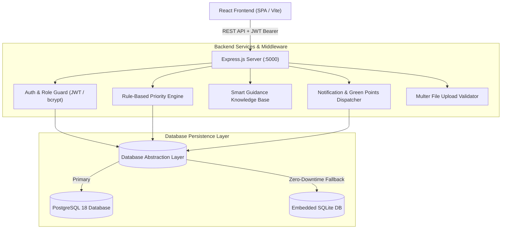

# 🌍 Civic Impact — Smart City, Civic Responsibility & Waste Management Platform

A modern, full-stack municipal and sustainability platform designed as a college semester capstone project. Civic Impact unites citizens, field service teams, and municipal administrators into a single circular platform to report civic hazards, schedule doorstep waste collection, exchange usable goods, learn responsible waste segregation, and earn Green Points.

---

## 📌 Table of Contents
1. [Project Overview & Key Features](#-project-overview--key-features)
2. [Technology Stack](#-technology-stack)
3. [System Architecture](#-system-architecture)
4. [Role-Based Access Control](#-role-based-access-control)
5. [Smart Rule-Based Engines](#-smart-rule-based-engines)
6. [Project Structure](#-project-structure)
7. [Installation & Setup Guide](#-installation--setup-guide)
8. [Database Configuration (PostgreSQL & Auto-Fallback)](#-database-configuration)
9. [Pre-Seeded Demo Accounts](#-pre-seeded-demo-accounts)
10. [REST API Documentation](#-rest-api-documentation)
11. [Running the Test Suite](#-running-the-test-suite)
12. [Future Improvements](#-future-improvements)

---

## 🚀 Project Overview & Key Features

### 1. 🚨 Civic Complaint Reporting & Lifecycle Tracking
- Citizens report civic problems across 8 categories: *Garbage/Waste, Pothole/Road, Streetlight, Water Leakage, Drainage, Public Toilet, Illegal Dumping, Other*.
- Automatic generation of unique Complaint IDs (e.g. `CMP-2026-1002`).
- 6-stage lifecycle tracking: `Submitted` → `Under Review` → `Assigned` → `In Progress` → `Resolved` → `Closed`.
- Visual progress stepper and full audit trail of notes from technicians and administrators.
- Photo upload support with GPS coordinate capturing.

### 2. ⚡ Transparent Rule-Based Smart Priority Engine
- Automatically scores complaints from 0 to 100 based on:
  - **Category urgency** (e.g. Drainage, Water Leakage, Illegal Dumping vs Streetlight)
  - **Critical safety keywords** (*live wire, sparking, open manhole, sinkhole, gas leak, accident, flooding*)
  - **Vulnerable impact areas** (*schools, hospitals, clinics, drinking water contamination*)
- Assigns priority tiers: `Low`, `Medium`, `High`, or `Critical`.
- Transparent reasoning displayed on every complaint card (e.g., *"Elevated to Critical due to proximity to school and keyword: live wire"*).
- Administrators can override priority anytime.

### 3. 🚛 Doorstep Waste Pickup Module
- Citizens book collection for segregated waste streams: *Dry Waste, Wet Waste, Plastic, Paper, Glass, Metal, E-waste, Other*.
- Unique Pickup IDs (e.g. `WPK-2026-101`).
- Lifecycle: `Requested` → `Scheduled` → `Assigned` → `Picked Up` → `Completed`.
- Municipal scheduling with confirmed calendar date and morning/afternoon time slots.
- Citizens earn **+20 Green Points** upon pickup completion.

### 4. 🎁 Reuse, Donate & Give Away Marketplace
- Peer-to-peer circular economy marketplace giving clothes, books, study materials, furniture, and toys a second life.
- Item conditions: *Like New, Gently Used, Functional, Needs Minor Repair*.
- Peer request workflow: Citizens submit adoption requests with personal messages.
- Anti-self-request security: Citizens cannot request their own listed items.
- Item owners can **Accept** or **Decline** requests. Acceptance automatically marks the listing completed and awards **+30 Green Points** to the donor and **+10 Green Points** to the recipient!

### 5. 🤖 "What Should I Do?" Smart Waste Assistant
- Deterministic, explainable recommendation advisor answering queries like *"I have old clothes"*, *"I have vegetable peels"*, or *"I have an old phone"*.
- Returns:
  - **Item Identified**
  - **Recommended Action** (*Reuse, Repair, Donate, Compost, Recycle, E-waste Collection, Safe Hazardous Disposal*)
  - **Ecological Reason**
  - **Alternative Option**
  - **Connected Civic Impact Gateway** (Direct shortcut button to appropriate module)
- Structured for clean future integration with external LLMs (e.g. Google Gemini API).

### 6. 📚 Waste Segregation Academy & Interactive Quiz
- Visual guide detailing Wet Waste, Dry Waste, E-Waste, and Domestic Hazardous Waste.
- Everyday examples, correct disposal actions, and searchable item directory.
- Interactive 4-question knowledge quiz awarding **+15 Green Points** upon completion.

### 7. 📍 Recycling Centres Directory
- Verified directory of local recycling hubs, e-waste dismantlers, and community composters.
- Filter by accepted materials (*Plastic, E-waste, Cardboard, Paper, Metal, Glass, Wet Waste*).
- Operating hours, contact telephone, email, and one-click Google Maps directions.

### 8. 🌱 Green Points & Privacy-Protected Leaderboard
- Citizen gamification awarding points for reporting issues (+10), complaint resolution (+25), waste pickup (+20), donation (+30), and quizzes (+15).
- Community leaderboard with All-Time and Monthly filter tabs.
- Top 3 podium display (Gold 🥇, Silver 🥈, Bronze 🥉).
- **Privacy First**: Displays public display names and points; never exposes private emails or phone numbers.

### 9. 🔔 In-App Notifications
- Real-time alerts for complaint assignments, status progressions, pickup schedules, donation requests, and Green Points earned.
- Unread badge counter, notification drawer, and "Mark all as read" capability.

---

## 💻 Technology Stack

| Layer | Technology | Rationale |
| :--- | :--- | :--- |
| **Frontend** | React 18 + Vite | Blazing fast client-side rendering with lightning HMR. |
| **Styling** | Tailwind CSS v3 | Clean, modern, environmental civic aesthetic. |
| **Icons** | Lucide React | Consistent, accessible, modern iconography. |
| **Routing** | React Router DOM v6 | Single-Page Application (SPA) client-side routing with role guards. |
| **Backend** | Node.js + Express.js | Standard, lightweight, beginner-friendly RESTful API server. |
| **Database** | PostgreSQL 18 (with SQLite fallback) | ACID-compliant relational DB with foreign keys, checks, indexes, and automated zero-downtime fallback. |
| **Authentication** | JWT + bcryptjs (Salt 10) | Stateless token-based auth with secure password hashing. |
| **File Uploads** | Multer | Safe disk storage for complaint and item photos (type and size validated). |

---

## 🏛️ System Architecture



---

## 👥 Role-Based Access Control

The platform provides 3 distinct roles:

1. **Citizen (`citizen`)**:
   - Report complaints, view their own history and timeline.
   - Schedule doorstep waste pickups.
   - Create donation listings, request peer items, accept requests.
   - Use the Smart Assistant, take segregation quizzes, earn Green Points, and view leaderboard.

2. **Service Team (`service_team`)**:
   - Access dedicated **Field Operations Desk** (`/service`).
   - View complaints and waste pickups specifically assigned to them.
   - Log field progress notes, upload resolution photos, and mark tasks `In Progress`, `Resolved`, or `Completed`.
   - **Restricted**: Cannot access admin user management or platform settings.

3. **Municipal Administrator (`admin`)**:
   - Access **Administrator Control Portal** (`/admin`).
   - View city-wide analytics, KPI metrics, and category charts.
   - Triage and assign complaints to service personnel.
   - Override complaint priorities with explicit reasoning.
   - Schedule and assign waste pickup dates.
   - Manage user roles (*Citizen ↔ Service Team ↔ Admin*).
   - Moderate/delete inappropriate reuse listings.
   - Full CRUD management over Recycling Centres and Educational Topics.

---

## 🧠 Smart Rule-Based Engines

### 1. Smart Complaint Priority Engine (`backend/services/priorityEngine.js`)
Calculates priority through transparent rule evaluation:
- **Critical (+40 pts)**: Detects keywords like *live wire, sparking, open manhole, gas leak, accident, sinkhole, fire, emergency*.
- **High (+20 pts)**: Detects factors like *school, hospital, clinic, overflowing sewage, burst pipe, major road*.
- **Category Weights**: Drainage (+20), Water Leakage (+20), Illegal Dumping (+25), Pothole (+15), Garbage (+15), Streetlight (+10).
- **Thresholds**: Score $\ge$ 50 $\rightarrow$ `Critical`; $\ge$ 30 $\rightarrow$ `High`; $\ge$ 15 $\rightarrow$ `Medium`; else $\rightarrow$ `Low`.

### 2. "What Should I Do?" Smart Assistant (`backend/services/assistantEngine.js`)
Deterministic material evaluation based on the ecological waste hierarchy:
- Categorizes items into *Wet Waste, Dry Waste, Textiles/Clothing, E-Waste, Bulky Furniture, Glass, Hazardous Chemicals, Toys, and Lead Batteries*.
- Returns actionable instructions, ecological reasoning, alternative fallbacks, and internal module routes.

---

## 📁 Project Structure

```text
Civic Impact/
├── backend/
│   ├── config/
│   │   └── db.js                 # PostgreSQL pool with automatic SQLite fallback
│   ├── controllers/
│   │   ├── adminController.js
│   │   ├── assistantController.js
│   │   ├── authController.js
│   │   ├── complaintController.js
│   │   ├── educationController.js
│   │   ├── greenPointsController.js
│   │   ├── listingController.js
│   │   ├── notificationController.js
│   │   ├── pickupController.js
│   │   └── recyclingController.js
│   ├── database/
│   │   ├── schema.sql            # Complete PostgreSQL schema
│   │   └── seed.js               # Demo dataset seeder
│   ├── middleware/
│   │   ├── authMiddleware.js     # JWT token validation
│   │   ├── roleMiddleware.js     # Role-based access control
│   │   └── uploadMiddleware.js   # Image upload handling (Multer)
│   ├── routes/                   # Express route definitions
│   ├── services/
│   │   ├── assistantEngine.js    # Rule-based item advisor
│   │   ├── notificationService.js# In-app alerts & Green Points
│   │   └── priorityEngine.js     # Rule-based priority calculator
│   ├── test/
│   │   └── api-test.js           # Automated end-to-end test suite
│   ├── uploads/                  # Uploaded photo files
│   ├── .env.example
│   ├── package.json
│   └── server.js                 # Main Express server entrypoint
│
├── frontend/
│   ├── src/
│   │   ├── components/
│   │   │   └── common/           # Navbar, Footer, StatCard, Badges, Modals
│   │   ├── context/
│   │   │   ├── AuthContext.jsx   # Authentication context & persistent storage
│   │   │   └── NotificationContext.jsx # Live notifications & toast popups
│   │   ├── pages/                # All application views (Landing, Dashboards, etc.)
│   │   ├── services/
│   │   │   └── api.js            # Axios client with interceptors
│   │   ├── App.jsx               # Routes & protected route guards
│   │   ├── index.css             # Tailwind directives & theme styles
│   │   └── main.jsx
│   ├── index.html
│   ├── package.json
│   ├── tailwind.config.js
│   └── vite.config.js
│
└── README.md
```

---

## 🛠️ Installation & Setup Guide

### Prerequisites
- **Node.js**: v18.0.0 or higher (Tested on Node v24)
- **npm**: v9.0.0 or higher
- **PostgreSQL**: (Optional but recommended; falls back gracefully to SQLite if offline)

### Step 1: Clone or Navigate to Directory
```powershell
cd "c:\Users\ASUS\Documents\Civic Imapct"
```

### Step 2: Install Backend Dependencies
```powershell
cd backend
npm install
```

### Step 3: Configure Environment Variables
Copy `.env.example` to `.env`:
```powershell
Copy-Item .env.example .env
```
Default `.env` configuration:
```env
PORT=5000
NODE_ENV=development

# PostgreSQL settings
DB_HOST=localhost
DB_PORT=5432
DB_USER=postgres
DB_PASSWORD=your_postgres_password
DB_NAME=civic_impact

# Auto-fallback to SQLite if PostgreSQL password is unknown
DB_ALLOW_SQLITE_FALLBACK=true

# JWT settings
JWT_SECRET=civic_impact_secure_jwt_token_secret_key_2026
JWT_EXPIRES_IN=7d
```

### Step 4: Seed Database with Demo Data
```powershell
npm run seed
```

### Step 5: Install Frontend Dependencies
```powershell
cd ../frontend
npm install
```

### Step 6: Start the Application

**Terminal 1 (Backend):**
```powershell
cd backend
npm start
```
*Backend runs on `http://localhost:5000`*

**Terminal 2 (Frontend):**
```powershell
cd frontend
npm run dev
```
*Frontend runs on `http://localhost:5173`*

---

## 🔑 Pre-Seeded Demo Accounts

The landing page and login page feature **1-click quick-fill buttons** for fast evaluation:

| Role | Email | Password | Green Points | Description |
| :--- | :--- | :--- | :--- | :--- |
| **Admin** | `admin@civicimpact.org` | `Password123!` | 50 | Full municipal portal access |
| **Service Team** | `service1@civicimpact.org` | `Password123!` | 120 | Zone Sanitation Lead (Field tasks) |
| **Service Team** | `service2@civicimpact.org` | `Password123!` | 90 | Public Works Field Engineer |
| **Citizen** | `citizen1@civicimpact.org` | `Password123!` | 310 | Active community member (Amina) |
| **Citizen** | `citizen2@civicimpact.org` | `Password123!` | 260 | Community member (Marcus) |
| **Citizen** | `citizen3@civicimpact.org` | `Password123!` | 185 | Community member (Elena) |

---

## 📡 REST API Documentation

### Authentication (`/api/auth`)
- `POST /register` — Register a new citizen account (+20 welcome points)
- `POST /login` — Authenticate and receive JWT token
- `GET /profile` — Fetch current user profile
- `PUT /profile` — Update name, phone, address, avatar
- `POST /change-password` — Change password with current password verification
- `GET /activity` — Fetch user complaints, pickups, listings, and point history

### Complaints (`/api/complaints`)
- `GET /` — List complaints (supports search, category, status, priority filters)
- `GET /:id` — Complaint details with visual timeline and assigned service member
- `POST /` — Submit complaint with photo (computes rule-based priority +10 pts)
- `PATCH /:id/status` — Service Team/Admin status updates and resolution notes (+25 pts)
- `PATCH /:id/assign` — Admin assigns complaint to service team member
- `PATCH /:id/priority` — Admin manual priority override

### Waste Pickups (`/api/pickups`)
- `GET /` — List pickup requests
- `POST /` — Schedule new doorstep waste collection
- `PATCH /:id/schedule` — Admin schedules confirmed date/time slot and assigns driver
- `PATCH /:id/status` — Update status to `Picked Up` or `Completed` (+20 pts)

### Reuse Marketplace (`/api/listings`)
- `GET /` — Browse listings (filter by category, type, condition)
- `POST /` — List item for donation, giveaway, or reuse
- `POST /:id/request` — Request item (blocked if requesting own item)
- `PATCH /:id/requests/:reqId` — Owner accepts/rejects request (+30 pts donor, +10 pts recipient)
- `DELETE /:id` — Moderate/remove listing

### "What Should I Do?" Smart Assistant (`/api/assistant`)
- `POST /ask` — Evaluates item query and returns recommendation, reason, alternative, and related module
- `GET /suggestions` — Returns popular quick queries

### Green Points & Leaderboard (`/api/points`)
- `GET /my` — User Green Points balance and transaction ledger
- `GET /leaderboard` — Community rankings (Overall or Monthly, privacy protected)
- `GET /rules` — Configurable point values breakdown

### In-App Notifications (`/api/notifications`)
- `GET /` — Get user notifications & unread counter
- `PATCH /:id/read` — Mark single notification as read
- `PATCH /read-all` — Mark all notifications as read

### Admin Operations (`/api/admin`)
- `GET /stats` — Platform-wide metrics and category breakdowns
- `GET /users` — User directory with search and role filters
- `PATCH /users/:id/role` — Update user permissions (`citizen`, `service_team`, `admin`)
- `GET /service-team` — List field technicians for dispatch

---

## 🧪 Running the Test Suite

Civic Impact includes an automated test runner:

```powershell
cd backend
npm test
```

Expected output:
```text
🧪 ========================================================
🧪 Starting Civic Impact Comprehensive Test Suite
🧪 ========================================================

  ✅ PASS: GET /health returns status OK and active database type
  ✅ PASS: POST /auth/login - Logs in Citizen successfully
  ✅ PASS: POST /auth/login - Logs in Service Team member
  ✅ PASS: POST /auth/login - Logs in Admin
  ✅ PASS: POST /auth/login - Rejects invalid password
  ✅ PASS: POST /auth/register - Registers new citizen with +20 welcome points
  ✅ PASS: GET /admin/stats - Blocks service team with 403 Forbidden
  ✅ PASS: GET /admin/stats - Admin successfully fetches KPI stats
  ✅ PASS: POST /complaints - Creates complaint and computes Critical priority
  ✅ PASS: PATCH /complaints/:id/assign - Admin assigns complaint to service team
  ✅ PASS: PATCH /complaints/:id/status - Service team marks Resolved
  ✅ PASS: POST /pickups - Citizen creates waste pickup request
  ✅ PASS: PATCH /pickups/:id/schedule - Admin schedules and assigns pickup
  ✅ PASS: PATCH /pickups/:id/status - Service team completes pickup (+20 Green Points)
  ✅ PASS: POST /listings - Citizen lists an item for donation
  ✅ PASS: POST /listings/:id/request - User CANNOT request their own item
  ✅ PASS: POST /listings/:id/request - Second citizen successfully requests item
  ✅ PASS: PATCH /listings/:id/requests/:reqId - Owner accepts request (+30 pts donor)
  ✅ PASS: POST /assistant/ask - Correctly categorizes old clothes as Donate
  ✅ PASS: POST /assistant/ask - Correctly categorizes vegetable peels as Wet Waste
  ✅ PASS: POST /assistant/ask - Correctly handles unknown items with safe fallback
  ✅ PASS: GET /points/my - Fetches points balance and transactions
  ✅ PASS: GET /points/leaderboard - Returns privacy-friendly community leaderboard
  ✅ PASS: GET /notifications - Fetches notifications and unread badge count
  ✅ PASS: PATCH /notifications/read-all - Marks all notifications as read
  ✅ PASS: GET /recycling - Lists verified sample recycling centres
  ✅ PASS: POST /education/quiz - Awards +15 points for quiz completion

🧪 ========================================================
🧪 Test Suite Finished: 27 Passed, 0 Failed
🧪 ========================================================
```

---

## 🔮 Future Improvements
1. **Google Gemini LLM Integration**: Connect the Smart Assistant to Google Gemini API with vision support to identify waste directly from captured photos.
2. **Interactive Map Coordinates with Leaflet / Mapbox**: Render visual pin drop maps for complaints and waste pickup routing.
3. **SMS / WhatsApp Gateway**: Integrate Twilio or WhatsApp Business API to dispatch SMS alerts when complaints reach `Resolved`.
4. **Offline PWA Support**: Progressive Web App service worker caching for field teams working in areas with patchy mobile reception.

---

## 📄 License & Attribution
Developed for college semester project evaluation. All rights reserved.
